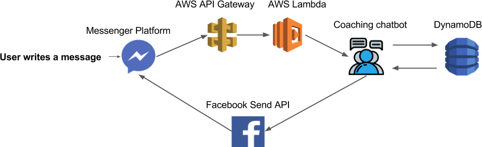
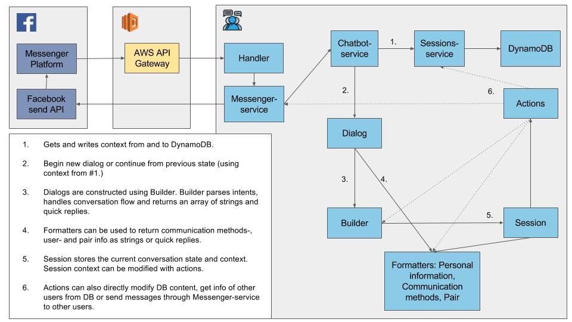
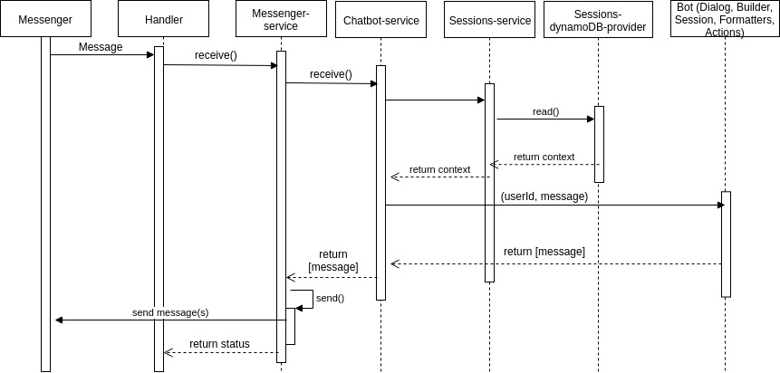

# General architecture

### Facebook messenger -> AWS -> Next-Level-Education -> AWS -> Facebook messenger

1. Facebook messenger receives a message from the user. The message is sent to AWS (API Gateway -> Lambda -> Serverless stuff).
2. Next-Level-Education receives the message and processes it.
3. Next-Level-Education calls any functions that are required to be called (save name to database, save occupation to database, see below). The database is DynamoDB.
4. Next-Level-Education sends a message back to Facebook Messenger

## High-level design diagram

## Low-level design diagram (non-chronological)

## Sequence diagram

